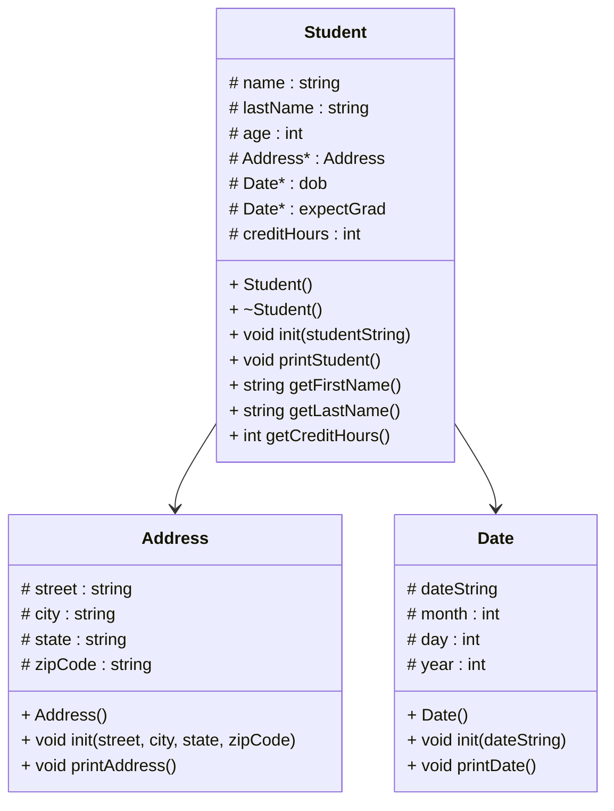

# Heap of students / Part 2

# Address
### Address:Address()
```
set street
set city
set state
set zipCode
```
### Address::init(street, city, state, zipCode)
```
// all should be strings
set street to street
set city to city
set state to state
set zipCode to zipCode
```
### Address::printAddress()
```
print state
print in the format of "city state, zipCode"
```
# Date
### Date::Date
```
set dateString
set month
set day
set year
```
### Date::init(dateString)
```
read dateString until "/" and put it into an int value
put into month
put into day
put into year
```
### Date::printDate()
```
using the int for the month, print out the month name (IE: 6 would be "June")
print the rest in the format of "June 6, 2006"
```
# Student
### Student::Student
```

```
