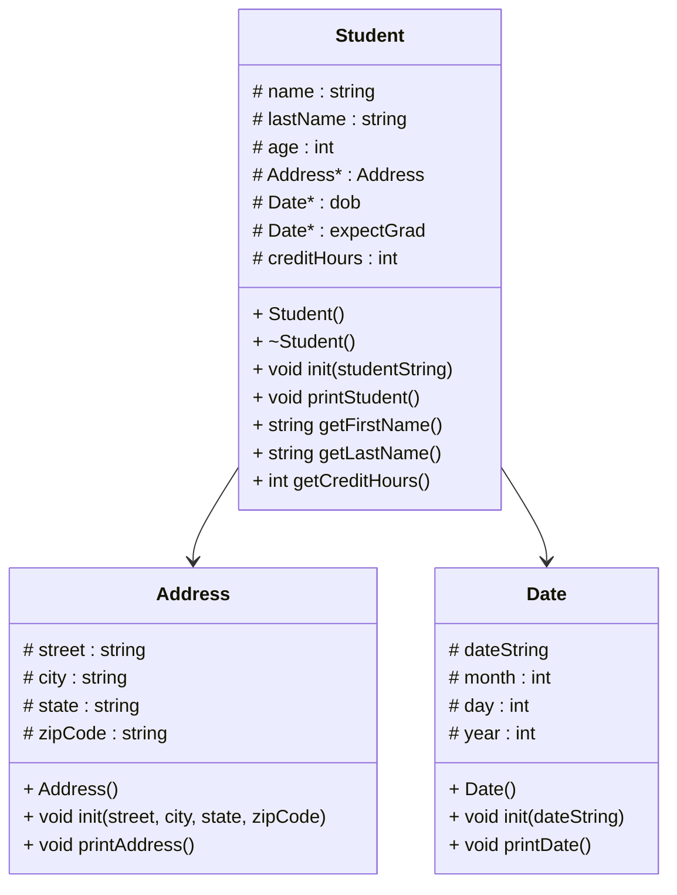

# Heap of students / Part 2

# Main
### main()
```
call menu function to display options to the user
  0 should end of the program // this shoudl always be zero
  1 should should print all of the student's names using printLastFirst() for formating
  2 should should use the printStudent function found inside of student.cpp for every line in the .csv file
  3 should prompt the user to search by LAST name for a student, and then the printStudent function should be used on only that student
```
### loadStudents
```
void loadStudents(reference to the vector of student pointers)
  create file input stream inFile
  create string currentLine
open inFile with students.csv
read each line using currentLine
  create an instance of Student on the heap
  push that student to the back of the vector
close input file
```
### showStudentNames
```
void showStudentNames()
  given a reference to a vector of student pointers
  go through one student at a time
  for each student
    print the student's last name, first name, and credit hours on a single line
```
### printStudents
```
void printStudents()
  use printStudents method from student.cpp
  print each student line by line
  
```
# Address
### Address:Address()
```
set street
set city
set state
set zipCode
```
### Address::init(street, city, state, zipCode)
```
// all should be strings
set street to street
set city to city
set state to state
set zipCode to zipCode
```
### Address::printAddress()
```
print state
print in the format of "city state, zipCode"
```
# Date
### Date::Date
```
set dateString
set month
set day
set year
```
### Date::init(dateString)
```
read dateString until "/" and put it into an int value
put into month
put into day
put into year
```
### Date::printDate()
```
using the int for the month, print out the month name (IE: 6 would be "June")
print the rest in the format of "June 6, 2006"
```
# Student
### Student::Student
```
set lastName
set firstName
set age
set address
set dob // date of birth
set expectGrad
set creditHours
```
### Student::~Student
```
delete all of the above from the heap to avoid memory leaks
```
### Student::init(studentString)
```
import stringstream as ss
read studentString until "," and place each part into respective variables
//IN ORDER! USING ("Danielle,Johnson,32181 Johnson Course Apt. 389,New Jamesside,IN,59379,02/17/2004,05/15/2027,65") AS A REFERENCE
set lastName //Danielle
set firstName //Johnson
set address // Johnson Course Apt. 389 // city = New Jamesside // state = IN // zipCode = 59379
set dob // 02/17/2004
set expectGrad //05/15/2027
set creditHours //65

```
### Student::printStudent()
```
print all of the information in the format requested by the assignment
```
### Student::getLastName()
```
return last name
```
### Student::getFirstName()
```
return first name
```
### Student::getCreditHours()
```
return credit hours
```
### Student::getLastFirst()
```
return last name + comma + first name
```
